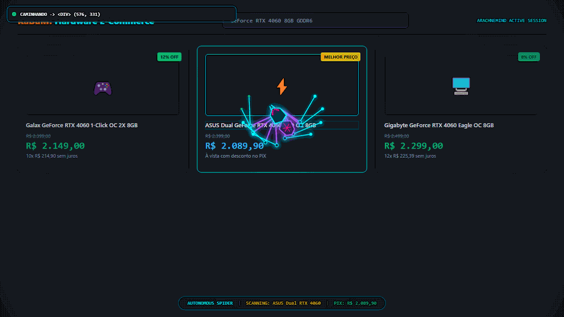
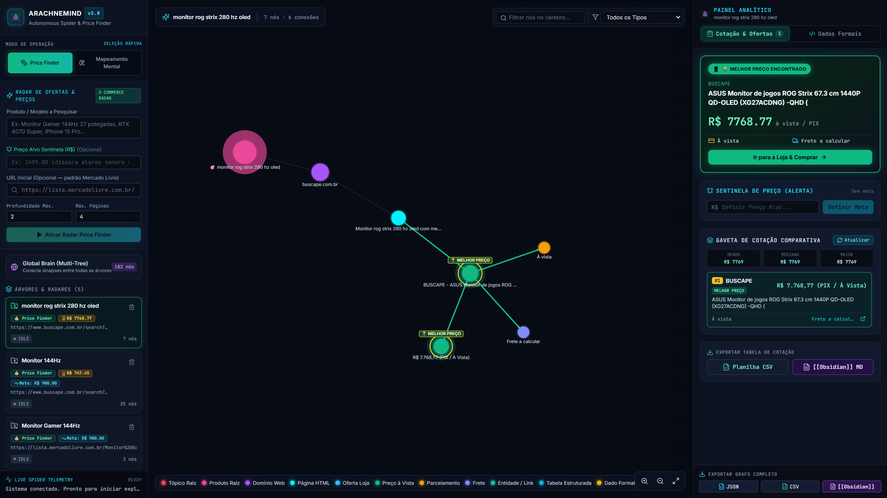
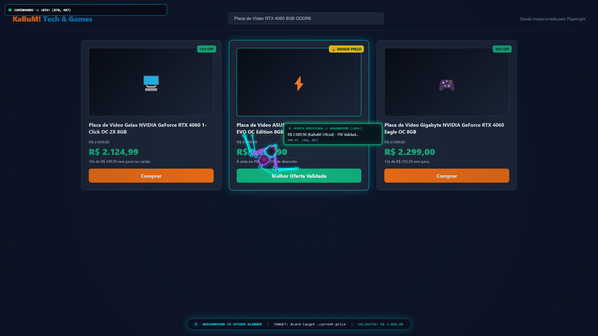
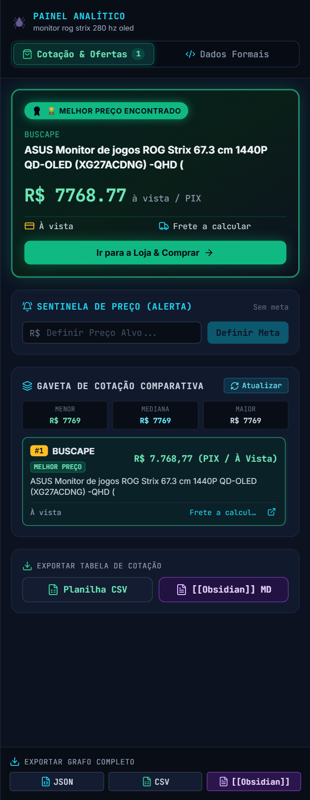
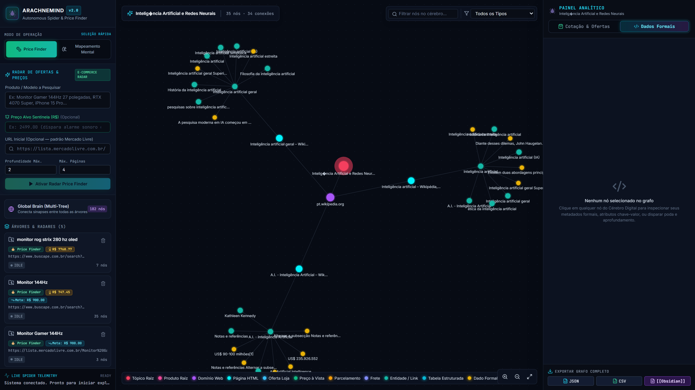

# ArachneMind
## Visual Autonomous Web Crawler & Obsidian-Style Interactive Knowledge Graph

[](https://github.com/brunofaomoura-max/arachnemind)
[](https://nodejs.org/)
[](https://playwright.dev/)
[](https://react.dev/)
[](https://www.typescriptlang.org/)
[](https://vitejs.dev/)
[](https://tailwindcss.com/)
[](LICENSE)

ArachneMind e uma plataforma full-stack de alto desempenho para exploracao autonoma, inspecao geometrica no Document Object Model (DOM) e extracao de dados estruturados da web. O sistema combina uma engine procedural de rastreamento visual executada em navegadores visiveis com resolucao de cinematica inversa analitica (Inverse Kinematics - IK), integrando os resultados em tempo real a um grafo de conhecimento bidimensional interativo no padrao Obsidian para mapeamento conceitual e comparacao de precos em multiplos marketplaces.

---

## Demonstracao Visual do Sistema


*Figura 1: Aranha procedural autonoma (8 apendices com IK de 2 articulacoes) navegando e inspecionando elementos e ofertas em tempo real sobre o DOM.*

---

## Sumario

- [Visao Geral](#visao-geral)
- [Tour Visual da Interface](#tour-visual-da-interface)
  - [Painel Principal e Grafo de Conhecimento](#1-painel-principal-e-grafo-de-conhecimento)
  - [Inspecao Procedural com Cinemática Inversa (IK)](#2-inspecao-procedural-com-cinematica-inversa-ik)
  - [Gaveta de Cotacao Comparativa e Sentinela de Preco](#3-gaveta-de-cotacao-comparativa-e-sentinela-de-preco)
  - [Mapeamento Mental e Extracao Estruturada de Tabelas HTML](#4-mapeamento-mental-e-extracao-estruturada-de-tabelas-html)
- [Arquitetura de Software](#arquitetura-de-software)
- [Motor Hibrido de Extracao de 4 Camadas](#motor-hibrido-de-extracao-de-4-camadas)
- [Filtragem Estatistica de Outliers e Acessorios](#filtragem-estatistica-de-outliers-e-acessorios)
- [Sentinela de Preco e Alerta Sonoro Polifonico](#sentinela-de-preco-e-alerta-sonoro-polifonico)
- [Especificacao da API REST](#especificacao-da-api-rest)
- [Formatos de Exportacao](#formatos-de-exportacao)
- [Pilha Tecnologica](#pilha-tecnologica)
- [Instalacao e Execucao](#instalacao-e-execucao)
- [Auditoria de Seguranca](#auditoria-de-seguranca)
- [Licenca](#licenca)

---

## Visao Geral

Diferente de raspadores estaticos convencionais baseados em HTTP puro ou motores headless sem telemetria em tempo real, o ArachneMind orquestra navegadores Chromium visiveis atraves do Playwright, injetando uma camada grafica procedural em HTML5 Canvas sobre o viewport. A aranha localiza elementos por proximidade euclidiana, projeta feixes direcionais de colimacao sobre nos de texto ou precos e extrai metadados normalizados.

Simultaneamente, os nos e conexoes estruturados sao despachados via WebSockets (Socket.io) para o cliente React, onde um motor de simulacao elastica orientada a forcas (Force-Directed Graph via D3.js) calcula posicoes, gravidade e repulsao eletrostatica em 60 quadros por segundo.

---

## Tour Visual da Interface

### 1. Painel Principal e Grafo de Conhecimento

O workspace unificado disponibiliza a barra lateral de sessoes ativas, o visualizador central force-directed e a gaveta analitica lateral.


*Figura 2: Workspace operacional completo do ArachneMind com nos de produto, ofertas de lojas, valores a vista no PIX com selo pulsante de Melhor Preco e conexoes sinapticas.*

### 2. Inspecao Procedural com Cinemática Inversa (IK)

A camada grafica no navegador resolve a fisica dos membros utilizando cinematica analitica em tempo real:


*Figura 3: Motor grafico da aranha resolvendo a marcha tetrapode (Tetrapod Gait) e disparando feixes colimados de medicao com reticulo holografico de telemetria.*

- **Resolucao Trigonometrica:** Cada perna calcula os angulos de femuro e tibia atraves da Lei dos Cossenos, adaptando a extensao dinamicamente as dimensoes da tela.
- **Tetrapod Gait:** Marcha coordenada alternando grupos de apoio e elevacao para simular a marcha biologica de aracnideos sobre os blocos visuais do DOM.
- **Magnifier HUD:** Reticulo colimado no topo da viewport indicando seletores CSS formais, tags semanticas e o valor numerico validado.

### 3. Gaveta de Cotacao Comparativa e Sentinela de Preco

Projetada para analise de dispersao de precos e identificacao instantanea da melhor condicao comercial entre multiplos varejistas (Buscape, Amazon Brasil, KaBuM! e Zoom).


*Figura 4: Gaveta analitica com card de Melhor Preco Encontrado, diferenca percentual vs maior preco, Sentinela de Preco Alvo e ranking tabular por loja.*

- **Card de Melhor Oferta:** Destaque numerico do menor valor encontrado com calculo automatico de economia percentual frente a media e ao maior preco coletado.
- **Painel de Sentinela:** Monitoramento de preco alvo com disparo automatico de sinal polifonico via Web Audio API assim que uma oferta atinge o limite estipulado.
- **Tabela Ranqueada:** Ordenacao crescente com identificacao de vendedor, miniatura do produto, condicoes de parcelamento no cartao, status de frete e links diretos para compra.

### 4. Mapeamento Mental e Extracao Estruturada de Tabelas HTML

No modo conceitual, o ArachneMind realiza a digestao semantica de artigos, documentacoes tecnicas e bases de conhecimento (ex: Wikipedia).


*Figura 5: Grafo conceitual em modo Mapeamento Mental com nos de Dominio Web, Paginas HTML, Tabelas Estruturadas (`data_table`) e Fatos Analiticos pontuados por densidade metrica.*

- **Isolamento de Corpus:** Descarte de barras de navegacao, rodapes, secoes de login e banners de consentimento LGPD para concentrar a analise no conteudo substantivo (`article`, `main`, `.mw-parser-output`).
- **Parsing Estruturado de Tabelas HTML:** Conversao direta de elementos `<table>` em nos formais com atributos de colunas/linhas e preview formatado em Markdown.
- **Sinapses Transversais (Global Brain):** Mecanismo de hashing semantico que interliga automaticamente sessoes de pesquisa diferentes que compartilham dominios ou termos conceituais em comum.

---

## Arquitetura de Software

```
+-----------------------------------------------------------------------------------------+
|                                  ARACHNEMIND ECOSYSTEM                                  |
+--------------------------------------------+--------------------------------------------+
|                  BACKEND                   |                  FRONTEND                  |
|             (Node.js / Express)            |          (React 18 / Vite / Tailwind)      |
+--------------------------------------------+--------------------------------------------+
|                                            |                                            |
|  [Playwright Visible Chromium Engine]      |  [Force-Directed 2D Graph Engine]          |
|    |-> HTML5 Canvas IK Spider Overlay      |    |-> D3.js Force Simulation Engine       |
|    |-> 4-Layer Hybrid Scraping Engine      |    |-> Canvas 2D Node Renderer with Pulses |
|    |-> Multi-Store Queue Orchestrator      |    \-> Synaptic Cross-Tree Links           |
|                                            |                                            |
|  [Core Processing & Business Logic]        |  [Analytics & User Controls]               |
|    |-> Statistical Median Outlier Filter   |    |-> Comparative Quotation Drawer        |
|    |-> Model Token Strict Matcher          |    |-> Web Audio API Harmonic Alert Synthesizer|
|    |-> HTML Table to Markdown Converter    |    |-> Workspace Manager (Price vs Mind Map)|
|    |-> Real-time WebSocket Broadcaster     |    \-> Obsidian Vault / CSV Exporters      |
|                                            |                                            |
+--------------------------------------------+--------------------------------------------+
                      |                                            ^
                      |         Socket.io Events & REST API        |
                      +────────────────────────────────────────────+
```

---

## Motor Hibrido de Extracao de 4 Camadas

O mecanismo implementado em `backend/src/scraper-engine.js` processa paginas web por meio de quatro estrategias coordenadas de extracao:

| Camada | Estrategia | Escopo de Aplicacao | Dados Extraidos |
| :--- | :--- | :--- | :--- |
| **Camada 1** | Hydration State (`__NEXT_DATA__`) | Portais baseados em Next.js (KaBuM!, etc.) | Precos liquidos no PIX, valores brutos no cartao, avaliacoes, fotos de alta resolucao e codigos SKU. |
| **Camada 2** | Schema.org JSON-LD | Paginas com microdados semanticos estruturados | Objetos formais `Product`, `Offer`, `AggregateOffer` e colecoes `ItemList`. |
| **Camada 3** | Adaptadores DOM Especializados | Amazon Brasil, Buscape e Zoom | Titulos limpos, nomes de lojas parceiras, selos de cashback, parcelamento e frete gratis. |
| **Camada 4** | Heuristica Visual Geometrica | E-commerces genericos e paginas sem metadados | Identificacao de cards por bounding box no viewport e parsing monetario regex. |

---

## Filtragem Estatistica de Outliers e Acessorios

Para garantir que o radar de precos apresente apenas ofertas legitimas do produto pesquisado sem ser ludibriado por anuncios patrocinados ou pecas acessorias, o motor aplica regras estritas de validacao:

1. **Verificacao de Tokens de Modelo:** Se o usuario busca por `RTX 4060` ou `Monitor 144Hz`, o motor rejeita qualquer anuncio que nao contenha os tokens especificos do modelo (impedindo a inclusao de uma `RTX 3050` ou `RX 7600` anunciada como patrocinada na listagem).
2. **Descarte de Acessorios Avulsos:** Eliminacao automatica de cabos, adaptadores, peliculas, suportes, pastas termicas e gabinetes vazios quando o objetivo de busca for o equipamento principal.
3. **Corte por Limites da Mediana Estatistica:**
   $$\text{Preco Minimo Valido} = 0.28 \times \text{Mediana}$$
   $$\text{Preco Maximo Valido} = 2.60 \times \text{Mediana}$$
   Valores abaixo de $28\%$ da mediana (geralmente cabos ou pecas avulsas) ou acima de $260\%$ (geralmente computadores completos anunciados com a peca no titulo) sao descartados do ranking principal.

---

## Sentinela de Preco e Alerta Sonoro Polifonico

O sistema permite configurar um valor alvo para cada arvore de pesquisa. O modulo de auditoria compara o menor preco em tempo real com a meta:

- **Sintetizador Web Audio API:** Sem carregar arquivos de audio externos, o navegador sintetiza dinamicamente um acorde senoidal duplo (frequencias fundamentais de $523.25\text{ Hz}$ e $659.25\text{ Hz}$) no exato instante em que o sentinela detecta uma queda de preco.
- **Painel de Notificacao:** Exibe a loja fornecedora, o desconto obtido e a acao imediata para redirecionamento.

---

## Especificacao da API REST

O backend disponibiliza endpoints HTTP para controle de sessoes, expansao e exportacao:

| Metodo | Endpoint | Descricao |
| :--- | :--- | :--- |
| `GET` | `/api/state` | Retorna o estado integral do grafo (arvores, nos, arestas e sinapses do Global Brain). |
| `POST` | `/api/trees/crawl` | Inicializa uma nova sessao de crawling autonomo (Price Finder ou Mapeamento Mental). |
| `POST` | `/api/trees/:treeId/stop` | Interrompe imediatamente a execucao do Playwright para a arvore especificada. |
| `POST` | `/api/trees/:treeId/refresh` | Dispara o re-escaneamento multi-lojas para atualizar as cotacoes da arvore ativa. |
| `GET` | `/api/trees/:treeId/quotes` | Retorna a consolidacao analitica de cotacoes ranqueadas, estatisticas de dispersao e economia. |
| `POST` | `/api/trees/:treeId/sentinel` | Configura ou remove o preco alvo de monitoramento do Sentinela. |
| `POST` | `/api/nodes/:nodeId/expand` | Comanda a aranha a aprofundar a exploracao web a partir de um no especifico do grafo. |
| `POST` | `/api/nodes/manual` | Insere uma anotacao ou dado formal manual vinculado a um no existente. |
| `DELETE` | `/api/nodes/:nodeId` | Executa a poda de um no individual ou cascata descendente completa (`?cascade=true`). |
| `DELETE` | `/api/trees/:treeId` | Exclui permanentemente uma arvore de pesquisa e todos os seus nos associados. |
| `GET` | `/api/trees/:treeId/quote-export` | Exporta a tabela comparativa de precos em formato tabular CSV (`?format=csv`) ou Markdown Obsidian (`?format=markdown`). |
| `GET` | `/api/trees/:treeId/export` | Exporta a arvore completa em JSON estruturado, CSV relacional ou Obsidian Vault com WikiLinks. |

---

## Formatos de Exportacao

1. **Obsidian Vault (`.md`):** Arquivos com frontmatter YAML, secoes estruturadas e sintaxe WikiLinks (`[[Node]]`) permitindo importacao direta no grafo de navegacao nativo do software Obsidian.
2. **Planilha Tabular (`.csv`):** Arquivo formatado com colunas de Rank, Status de Melhor Preco, Loja, Titulo do Produto, Preco a Vista, Condicoes de Parcelamento, Frete, Taxas de Economia e Link Direto.
3. **JSON Estruturado (`.json`):** Estrutura completa serializada contendo arrays relacionais de `trees`, `nodes` e `edges` com carimbos ISO 8601 e seletores CSS formais.

---

## Pilha Tecnologica

| Dominio | Tecnologia | Finalidade |
| :--- | :--- | :--- |
| **Interface do Operador** | React 18, Vite | Ciclo de vida da aplicacao reativa e gestao de estado |
| **Renderizacao do Grafo** | react-force-graph-2d, D3.js | Simulacao elastica orientada a forcas (Charge, Link, Gravity) |
| **Estilizacao Visual** | Tailwind CSS | Layout dark mode de alta densidade visual e responsividade |
| **Servidor de Aplicacao** | Node.js, Express | Roteamento REST e orquestracao concorrente de tarefas |
| **Streaming em Tempo Real** | Socket.io | Emissao bidirecional de eventos e telemetria de inspecao |
| **Automacao de Navegador** | Playwright (Chromium) | Controle do browser e projecao do canvas procedural de IK |
| **Motor de Audio** | Web Audio API | Sintese de alertas harmonicos polifonicos sem dependencias externas |

---

## Instalacao e Execucao

### Requisitos de Ambiente
- **Node.js:** Versao 18.0.0 ou superior.
- **npm:** Versao 9.0.0 ou superior.
- **Sistema Operacional:** Windows, Linux ou macOS.

### Passo 1: Clonar o Repositorio
```bash
git clone https://github.com/brunofaomoura-max/arachnemind.git
cd arachnemind
```

### Passo 2: Inicializar o Servidor Backend
Abra um terminal e execute:
```bash
cd backend
npm install
npx playwright install chromium
npm start
```
*O orquestrador sera inicializado na porta 4000 (`http://localhost:4000`). O banco local sera gerado automaticamente caso nao exista.*

### Passo 3: Inicializar a Interface Frontend
Em um terminal paralelo, execute:
```bash
cd frontend
npm install
npm run dev
```
*Acesse o painel web no endereco `http://localhost:5173`.*

---

## Auditoria de Seguranca

O codigo-fonte deste projeto e sua arvore de dependencias foram submetidos a processo de inspecao e auditoria estatica de seguranca com o framework **NVIDIA SkillSpector**, atestando conformidade com padroes de desenvolvimento seguro, ausencia de scripts de execucao arbitraria e protecao contra exfiltracao de credenciais.

---

## Licenca

Este projeto e distribuido sob a licenca MIT. Consulte o arquivo [LICENSE](LICENSE) para obter os termos e condicoes integrais.

---

Autor: **Bruno Fao Moura**  
Repositorio Oficial: [https://github.com/brunofaomoura-max/arachnemind](https://github.com/brunofaomoura-max/arachnemind)
